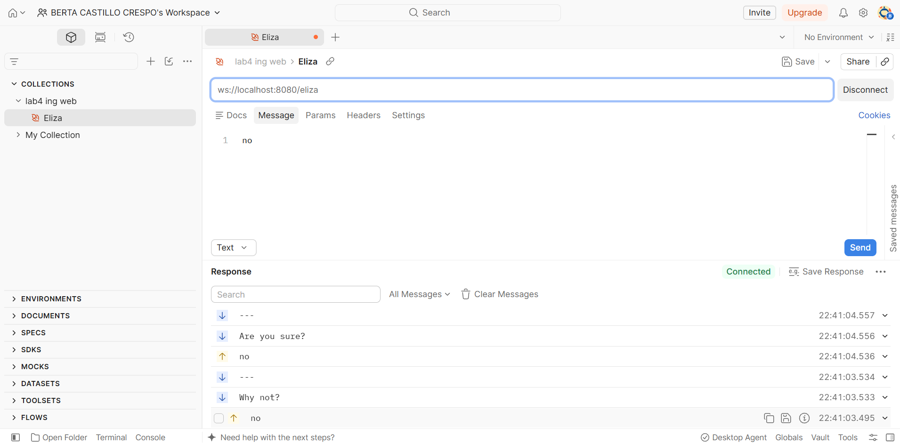
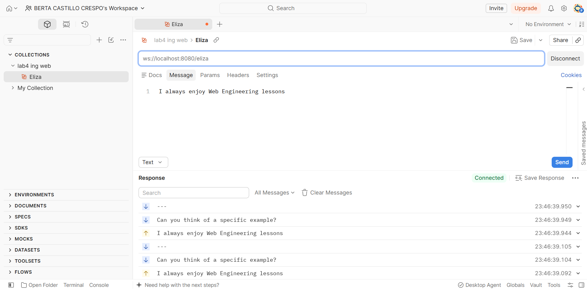

# Lab 4 WebSocket -- Project Report

## What I specified

I decided to send the sentence *"I always enjoy Web Engineering lessons"* to the doctor and to expect the answer *"Can you think of a specific example?"*.

My decision is based on the fact that the answer must always be the same for the request, and Eliza has a deterministic behaviour for the keyword "always". This means that every time the server finds the word "always" in a sentence, it returns the answer *"Can you think of a specific example?"*.

I would know that the test works when `onChat` passes on every run, regardless of whether the machine is fast or slow.

## What I changed

I only changed the test file `src/test/kotlin/websockets/ElizaServerTest.kt`. `Eliza.kt` and `ElizaServer.kt` were not modified.

- **`onChat`**: I disabled the `@Disabled` annotation so the test runs, and I used `assertTrue` to expect 4 or 5 messages from the server. The size is not fixed to 4 or to 5 because the test and client threads run in parallel and the execution order is not deterministic. The order depends on the machine and on aspects such as the operating system, the number of CPUs or the scheduling. I also used `assertEquals` to check that `list[3]` is the doctor's answer *"Can you think of a specific example?"*.
- **`ComplexClient.onMessage`**: the client sends the sentence *"I always enjoy Web Engineering lessons"* only when the three greeting messages have arrived. This is checked with the size of the message list (`list.size == 3`), because if we only looked at the message `---` it would match both the one from the greeting and the one after the response, resulting in multiple requests being sent.
- **Comments**: I answered questions 1 to 6 of the starter as comments in the test.

## Technical decisions

I made the following technical decisions:

- **Sentence and answer:** I chose that sentence because Eliza only has one response to it. If any other sentence is used for which Eliza can send multiple responses, the result would be non-deterministic and the test could fail randomly.
- **Keyword order:** Eliza tries to match the keywords in the order they are defined in the `responses` map of `Eliza.kt` (its keys form the `keywords` set). Because "always" is checked first, other words in the sentence cannot change the keyword, so the reply is always the same. Keywords with several answers (`yes`, `no`, `i am`, `dream`, ...) or sentences with no keyword get a random reply and would make the test unpredictable.
- **Interval instead of an exact size:** the `CountDownLatch` waits for 4 messages (the three greeting messages and the reply). The final `---` after the reply may or may not have arrived when the test thread reads the list, so `size` is read only once and checked with `assertTrue(size in 4..5)`. I rejected `assertEquals(4, size)` because it would pass on some machines and fail on others.
- **Sending condition:** I rejected checking only `message == "---"`, because it would also match the `---` after the reply and send the sentence again.

## How I verified

I ran the following commands:

```bash
./gradlew test
./gradlew ktlintCheck
./gradlew check
```

The first runs of `./gradlew check` failed because of code style, not because of the test logic. ktlint reported a commented-out import in the import list, a double space before a comment and trailing spaces at the end of two comment lines. I fixed them with `./gradlew ktlintFormat` and by removing the unused `Disabled` import. After that, `./gradlew check` completed successfully with both tests (`onOpen` and `onChat`) executed and passing.

The test logs in `build/test-results/test` show that the messages are received on different client threads (for example `[ient-AsyncIO-15]` and `[ient-AsyncIO-16]`), which confirms the concurrency problem described above.

I also tested it manually from the Postman website, connecting to `ws://localhost:8080/eliza` after starting the server with `./gradlew bootRun`. I tried different messages and saw that the response was deterministic in some cases and not in others.

Non-deterministic response:



Deterministic response (as expected from how Eliza is programmed):



## AI disclosure

- **Tools / skills:** Claude Opus 5.5 in VS Code (Claude Code), with the project files `CLAUDE.md` and `.claude/skills/lab4-websocket/SKILL.md`.
- **Purpose:**
    - Explain the problem the test faces with concurrency and non-deterministic behaviour.
    - Explain how to test the server manually with Postman.
    - Style and format of the report.
- **Representative prompts:**
    - "Explain why the size of the list can be 4 or 5 in the test, depending on the machine."
    - "Edit REPORT.md with the style and format of these other reports."
- **Affected files/sections:** `REPORT.md` and `src/test/kotlin/websockets/ElizaServerTest.kt`.
- **Validation steps:** I ran `./gradlew ktlintFormat`, `./gradlew ktlintCheck` and `./gradlew check`, fixed the ktlint violations and tested the endpoint manually with Postman.
- **Citations:** none.
- **Human-reviewed:** I checked manually that the behaviour described was true. I chose the sentence and the sending condition (`list.size == 3`). I checked that the report contained my original content, formatted appropriately.
